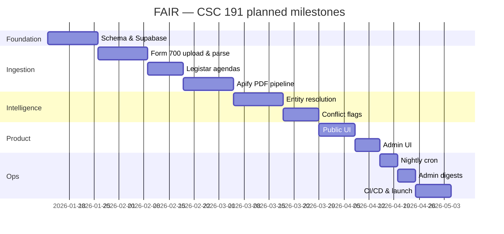

<p align="center">
  
</p>

<p align="center">
  <strong>Transparency at the intersection of public finance and local government.</strong>
</p>

<p align="center">
  
  
  
  
</p>

---

## Synopsis 

**FAIR** (*Financial Accountability & Interest Review*) is a full-stack compliance platform built for the **California Fair Political Practices Commission (FPPC)**. It helps analysts and the public see when local officials’ **Form 700** financial disclosures may overlap with **city council agenda** items—surfacing potential conflicts of interest before votes happen.

The system ingests structured agenda data (**Legistar REST**), PDF-only city agendas (**Apify** + `pdf-parse`), and admin-uploaded **Form 700** spreadsheets (archived in **Supabase Storage**). Parsed entities are matched with **fuse.js**; explicit ambiguous bands can be escalated to **Gemini 1.5 Flash** (agenda entities: **0.70–0.899…**; politician deduplication: **0.70–0.849…**). A **node-cron** scheduler can keep data fresh; Resend weekly digests remain planned rather than implemented.

| Audience | Experience |
|----------|------------|
| **Public** | Browse officials, agendas, and flagged overlaps — no login required |
| **FPPC admins** | Upload Form 700 files, manage/enable/disable sources, review conflict flags, and approve or reconcile politician profiles — Supabase Auth (no public registration) |

---

## At a glance

<p align="center">
  
</p>

| Layer | Location | Hosting target |
|-------|----------|----------------|
| Frontend | `client/` | Vercel |
| API & jobs | `server/` | Railway |
| Database & storage | `supabase/` | Supabase (PostgreSQL + Storage) |
| Agenda scraping | `apify/` | Apify Actor |

> **Repo map:** agents and contributors should start with [`CLAUDE.md`](CLAUDE.md), then use [`DIRECTORY.md`](DIRECTORY.md) to load only the files needed for a task. Generic coding agents can enter through [`AGENTS.md`](AGENTS.md).

---

## Data model (ERD)

The authoritative relational model is defined in [`server/prisma/schema.prisma`](server/prisma/schema.prisma):

<p align="center">
  
</p>

**Form 700 schedules** parsed from XLSX: **A** (investments), **B** (real estate), **C** (income), **D** (gifts), **E** (travel), **A-2** (business positions). See [`docs/fair/form700-ingestion/CONTEXT.md`](docs/fair/form700-ingestion/CONTEXT.md).

### Admin Form 700 imports

Sign in and open `/admin/upload`. Use **Bulk Form 700 import** for county/agency
NetFile exports containing multiple filers (XLSX, maximum 10 MB). Preview the
filer/year groups, selected submissions, schedule counts and warnings, acknowledge
the completeness warnings, then confirm the import. The single-filing uploader
remains available for cover-page workbooks. PDF/scanned forms are not supported.

Bulk imports match exact names within the source agency's jurisdiction; new
profiles are flagged for admin review. Only the latest submission per filer/year
is active. Earlier submissions remain in the archived original workbook and
version metadata; missing schedules are **not** carried forward from older
submissions. This is not a reconstruction of amendment history. Review incomplete
amendments before importing. Existing filer/year filings are skipped, never
overwritten, so retries do not duplicate successful imports.

Open `/admin/history` to review confirmed import attempts, warnings, filer-level
outcomes, and legacy imports reconstructed from filing metadata.

Admin sign-in validates the Supabase session against the protected server before
entering the admin area. Ensure the browser and server use the same Supabase
project and set `FAIR_ADMIN_EMAIL` on the server to the authorized account.

Apply Prisma migrations and regenerate the client before using bulk imports:
`cd server && npx prisma migrate deploy && npx prisma generate`.
For a trusted server-side import, run `node scripts/import-form700.mjs /absolute/path/workbook.xlsx`
from `server/` to preview, then repeat with the printed digest as the second
argument to confirm. Uses the same database/storage configuration as the API;
never expose this script or privileged credentials to public visitors.

---

## Screenshots & prototypes

Add captures under `docs/assets/screenshots/` as the UI matures in CSC 191:

| View | File (add when ready) | Status |
|------|------------------------|--------|
| Public home / search | `docs/assets/screenshots/home.png` | _placeholder_ |
| Official profile + disclosures | `docs/assets/screenshots/official.png` | _placeholder_ |
| Agenda item + conflict flag | `docs/assets/screenshots/conflict.png` | _placeholder_ |
| Admin Form 700 upload | `docs/assets/screenshots/admin-upload.png` | _placeholder_ |

_Current scaffold — replace with real screenshots:_

```
client/app/routes/home.tsx          → public landing
client/app/routes/admin.login.tsx   → admin auth
client/app/routes/admin.sources.tsx → source management
```

---

## Repository layout

```
Senior-Project/
├── client/          # React Router 7 + Tailwind (public + admin UI)
├── server/          # Express API, parsers, Prisma, cron jobs
├── supabase/        # SQL migrations, Storage policies
├── APIs/            # Python / Legistar agenda helpers
├── docs/
│   ├── assets/      # README logos, ERD, architecture, screenshots
│   └── fair/        # Feature workspaces (ingestion, matching, cron, email)
├── .github/workflows/
└── CLAUDE.md        # Workspace map for contributors & agents
```

---

## Developer instructions

### Provisional SH-324 eligibility

**PROVISIONAL — CLIENT APPROVAL PENDING.** Automatic conflict detection requires
an unambiguous canonical jurisdiction and meeting date. Filing-period eligibility
defaults to pending (no new automatic candidates); to opt into the provisional
calendar-year-offset policy, set `FAIR_FILING_PERIOD_OFFSETS` to comma-separated
nonnegative meeting-year minus filing-year offsets, for example `0,1`.
Existing candidates are retained while policy is pending. Admin review is still
required; see `docs/conflict_rules.md` for lifecycle and missing-data behavior.

> **CSC 191 — placeholder.** Expand this section with full local-setup steps, env var matrix, and troubleshooting as the team finalizes the dev environment in class.

### Prerequisites (target stack)

- **Node.js** 22+
- **npm** (lockfiles at the repository root and in each application package)
- **Supabase** project (Postgres + Storage + Auth)
- Optional: **Vercel** CLI, **Apify** token, and **Gemini** API key. Resend notifications are planned but not implemented.

### Quick start (draft)

```bash
# 1. Clone
git clone <your-repo-url>
cd Senior-Project

# 2. Backend
cd server
# Create .env with DATABASE_URL, DIRECT_URL, SUPABASE_URL,
# SUPABASE_SECRET_KEY, FAIR_ADMIN_EMAIL, APIFY_TOKEN, and APIFY_ACTOR_ID.
npm install
npx prisma migrate deploy # includes politician review/reconciliation audit history
npm run dev             # http://localhost:<PORT from src/index.js>

# 3. Frontend (separate terminal)
cd ../client
npm install
npm run dev             # Vite dev server (default port in terminal output)
```

### Branch workflow

| Branch | Purpose |
|--------|---------|
| `main` | Production-ready; deploys after CI |
| `dev` | Integration branch before merging to `main` |
| `feature/*` | Individual features / user stories |

### Environment variables

| Variable | Used by | Notes |
|----------|---------|-------|
| `DATABASE_URL` | Prisma / server | Supabase session pooler URI |
| `DIRECT_URL` | Prisma Migrate | Direct Postgres connection |
| `SUPABASE_URL` + `SUPABASE_SECRET_KEY` | server | URL and secret/service-role key; the secret key is server-only |
| `FAIR_ADMIN_EMAIL` | server | Exact verified Supabase Auth email permitted to use admin endpoints; missing or non-matching values are rejected with 401 |
| `APIFY_ACTOR_ID` | server | e.g. `fppc-csus~fair-agenda-pdf-scraper` |
| `GEMINI_API_KEY` | server | Entity resolution band only |
| `RESEND_API_KEY` | server | Reserved for planned weekly admin digests; currently unused |

The frontend uses its own `client/.env` with `VITE_API_URL`, `VITE_SUPABASE_URL`, and `VITE_SUPABASE_ANON_KEY`. Only `VITE_*` values are exposed to the browser; never place `SUPABASE_SECRET_KEY`, database URLs, or API tokens there.

### Production admin verification

Before release, set `FAIR_ADMIN_EMAIL` in the server deployment to the agreed
Supabase Auth administrator email. Verify that account can call an admin route
with a valid session, and verify a second valid Supabase account receives 401.
Do not place the email, service-role key, or any production token in client
environment variables.

### _To complete in CSC 191_

- [ ] Document exact local ports and proxy rules between `client/` and `server/`
- [ ] Prisma migrate + seed instructions for fresh Supabase projects
- [ ] Supabase Storage bucket setup (`form700` uploads) — [`supabase/migrations/`](supabase/migrations/)
- [ ] One-command dev script or root `package.json` workspaces (optional)
- [ ] Contributor checklist (lint, typecheck, pre-push hooks)

---

## Testing

FAIR uses **Vitest** across the React client, Express server, and Apify Actor. Frontend component tests use React Testing Library, while backend HTTP tests use Supertest.

### What exists today

| Area | Path | Notes |
|------|------|-------|
| Form 700 schedule parsers | `server/tests/unit/` | Schedules A, B, C/D/E |
| Legistar ingestion | `server/tests/integration/legistarIngestion.test.js` | Integration |
| Core upload → ingestion → detection → review → public display journey | `server/tests/functional/coreJourney.test.js` | Database-backed functional test |
| Fixtures | `server/tests/fixtures/*.xlsx` | Valid + malformed samples |
| Frontend UI and auth helpers | `client/app/**/*.test.ts(x)` | Vitest + React Testing Library |
| Apify discovery, network, runtime, and scraping | `apify/tests/*.test.ts` | Vitest |

```bash
# From the repository root: documentation and every unit suite
npm test

# Generate text, HTML, and LCOV coverage reports for each application
npm run test:coverage

# Run the deterministic database-backed core journey against an isolated migrated
# PostgreSQL database whose DATABASE_URL and DIRECT_URL contain "fair_test"
RUN_FUNCTIONAL_TESTS=true npm run test:functional

# Run a package in watch mode while developing
npm --prefix client run test:watch
npm --prefix server run test:watch
npm --prefix apify run test:watch

# Additional validation
npm run docs:check
npm --prefix client run typecheck
npm --prefix client run build
npm --prefix apify run build
```

### Legistar automation and historical backfills

Enabled Legistar sources are synchronized automatically by the server's nightly
cron job. Each source can point at any public Legistar client URL in the form
`https://webapi.legistar.com/v1/<client-id>`. The importer paginates meeting
results, ignores hidden/test meetings, and stores normalized agenda text and
source links for conflict review.

Run a bounded historical import for one jurisdiction with:

```bash
npm --prefix server run backfill:legistar -- --city "Sonoma County" --start 2024-01-01 --end 2025-12-31
```

Omit `--city` to backfill every enabled Legistar source. If `--start` is omitted,
the command imports the previous two years. Re-running the command is safe:
Legistar item IDs prevent duplicate agenda rows.

### Admin source management and fictional engine check

Open `/admin/sources` while signed in as an administrator. The **Legistar
cities/counties** and **Scraped cities/counties** tabs list configured sources,
their URLs, enabled state, last successful collection, stored agenda counts,
and errors. Each tab has an add-city/county form; scraped sources can use the
server's default `APIFY_ACTOR_ID`. Select **Sync immediately after saving** to
start collection, or use **Sync now** later. Legistar syncs accept an optional
historical date range. Source configuration, collection results, and sync logs
are persisted in the configured Supabase PostgreSQL database.

The **Fictional conflict-engine check** panel creates explicitly synthetic
database records: a fictional official, a Form 700 Schedule C income disclosure,
a matching agenda, and a negative-control agenda. It invokes the real matcher
twice and verifies one stored INCOME flag, no control flag, and no duplicate.
This tests database-to-detection behavior, not XLSX parsing or Storage uploads.
Use **Remove fictional test data** to remove only this fixture. Demo officials
and agendas have `is_demo = true`; they are excluded from public search, lists,
detail endpoints, and exports and cannot match ordinary disclosure records.

Before deploying this version, run `npx prisma migrate deploy` from `server/`
and regenerate the Prisma client. The migration adds demo markers and namespaces
legacy numeric Legistar item keys by client without changing agenda UUIDs. It
refuses ambiguous legacy source ownership rather than guessing. New keys use
`<client-id>:<numeric-item-id>`; original numeric IDs remain in the raw payload.

Coverage reports are written to each package's ignored `coverage/` directory. Coverage is measured across application source files, but no percentage gate is enforced yet; establish thresholds from the recorded baseline instead of selecting an arbitrary target.

The core functional test runs automatically in CI after Prisma migrations. It uses the real Express routes, Prisma database, Form 700 parsers, Legistar and Apify/PDF ingestion services, conflict detector, review persistence, search, CSV export, and report template. Supabase Auth/Storage, upstream Legistar/Apify/PDF network responses, and Chromium's PDF bytes are deterministic test doubles so the scenario remains repeatable and does not require production credentials.

The admin login stores the complete Supabase session under `fair.admin.session`, including the refresh token used to renew an expired access token. If the public Supabase URL or anon key is missing or still contains the placeholder value from `client/.env.example`, the login page displays setup guidance instead of exposing a fake privileged session.

### _To complete in CSC 191_

- [ ] Integration tests for fuse.js + Gemini resolution boundaries (0.7 / 0.85)
- [ ] Add a browser-driven staging smoke test on top of the database-backed core functional journey
- [ ] Coverage threshold in [`.github/workflows/ci.yml`](.github/workflows/ci.yml)

---

## Deployment

> **CSC 191 — placeholder.** Production runbooks, secrets rotation, and rollback steps will be added as pipelines go live.

### Target topology

| Component | Platform | Trigger |
|-----------|----------|---------|
| `client/` | **Vercel** | Push to `main` (or preview on PR) |
| `server/` | **Railway** | Railway GitHub autodeploy after successful CI |
| Database | **Supabase** | App migrations in `server/prisma/migrations/`; Supabase-only SQL in `supabase/migrations/` |
| Scheduled Legistar sync | **Target: GitHub Actions** | Workflow file is currently disabled |
| Scheduled Apify PDF ingestion | **Target: GitHub Actions** | Workflow file is currently disabled |

CI workflow: [`.github/workflows/ci.yml`](.github/workflows/ci.yml) uses Node.js 22, validates documentation navigation, uses a temporary Postgres service, runs `prisma generate` and `prisma migrate deploy`, executes all client/server/Actor unit suites, type-checks and builds the client, and builds the Apify Actor. Railway can deploy directly from GitHub: configure root directory `server`, pre-deploy command `npx prisma migrate deploy`, start command `npm start`, and healthcheck path `/health`. Keep `CRON_ENABLED=false` when an external scheduler is enabled; otherwise scheduling is provided by the server's `node-cron` process.

The checked-in scheduled workflow files contain only `# disabled`. If re-enabled, they will require GitHub repository secrets `DATABASE_URL`, `DIRECT_URL`, and `APIFY_TOKEN`, plus repository variable `APIFY_ACTOR_ID`. Do not store `RAILWAY_TOKEN`, `RAILWAY_SERVICE_ID`, or other Railway deployment identifiers in runtime environment files.

### _To complete in CSC 191_

- [ ] Vercel project linked to `client/` with env vars for API base URL
- [ ] Railway service linked directly to GitHub with Wait for CI enabled
- [ ] Supabase production vs staging projects documented
- [ ] Scheduled workflow notifications and failure alerts configured
- [ ] Post-deploy smoke checklist (health route, sample ingestion, admin login)

### Backend CORS configuration

Set `CLIENT_ORIGIN` in `server/.env` to the frontend's exact origin,
including its scheme and port when applicable, without a trailing slash.

Local example: `CLIENT_ORIGIN=http://localhost:5173`

Production example: `CLIENT_ORIGIN=https://your-app.vercel.app`

Development defaults to `http://localhost:5173` when unset.
Production disables CORS when `CLIENT_ORIGIN` is unset.
CORS controls browser access; admin routes also require authentication.

---

## CSC 191 timeline (JIRA backlog)

Planned delivery for **CSC 191** based on backlog user stories and story-point estimates. Sync keys and dates with your team board:

**JIRA board:** _[add your Atlassian project URL, e.g. `https://<team>.atlassian.net/jira/software/projects/FAIR`]_

| Week | Milestone | JIRA | User story (summary) | Est. |
|:----:|-----------|------|----------------------|-----:|
| 1–2 | **Foundation** | FAIR-1 | Supabase schema, Prisma models, RLS & Storage bucket for Form 700 | 8 |
| 2–3 | **Form 700 ingestion** | FAIR-2 | Admin XLSX upload, parse schedules A–E & A-2, persist filings | 13 |
| 3–4 | **Legistar agendas** | FAIR-3 | Pull meetings/agenda items/votes for Legistar cities; normalize shape | 8 |
| 4–5 | **PDF / Apify pipeline** | FAIR-4 | Apify actor for non-Legistar cities; source URL retention → PDF parse → agenda items → conflict detection | 13 |
| 5–6 | **Entity resolution** | FAIR-5 | fuse.js matching; Gemini only in feature-specific ambiguous bands; audit log | 13 |
| 6–7 | **Conflict detection** | FAIR-6 | Create/update `ConflictFlag` records; severity & status workflow | 8 |
| 7–8 | **Public UI** | FAIR-7 | Browse officials, agendas, flags; search & detail pages | 8 |
| 8 | **Admin UI** | FAIR-8 | Login, upload UI, source config, flag review queue | 8 |
| 9 | **Automation** | FAIR-9 | `node-cron` nightly sync; job monitoring | 5 |
| 9 | **Notifications** | FAIR-10 | Resend weekly digest for new/changed flags | 5 |
| 10 | **Ship** | FAIR-11 | CI/CD hardening, deployment, test pass, demo & docs | 8 |

**Total estimated:** ~97 story points across the term (adjust per sprint capacity).



_Update JIRA keys (`FAIR-*`) and calendar dates when your PO locks the 191 sprint schedule._

---

## Tech stack

| Concern | Choice |
|---------|--------|
| UI | React 19, React Router 7, Tailwind CSS 4, Vite |
| API | Node.js, Express 4 |
| ORM / DB | Prisma, PostgreSQL (Supabase) |
| Auth & files | Supabase Auth (admin only), Supabase Storage |
| Agendas | Legistar REST, Apify, `pdf-parse` |
| Form 700 | SheetJS `xlsx` |
| Matching | `fuse.js`, Gemini 1.5 Flash (ambiguous band) |
| Email | Resend (planned; not implemented) |
| Jobs | `node-cron` (no Redis/BullMQ) |

---

## Documentation index

### Deployable Apify Actor

**Admin city discovery:** On the admin Sources page, use **Find city council
agendas**, enter a California city name, and select **Find and scrape agendas**.
The server uses `APIFY_ACTOR_ID` and `APIFY_TOKEN`; rebuild the Actor from the
updated `apify/` folder before using city-only input. No new database migration
or search-provider key is required. The Actor resolves exact city-government
matches from CISA's `.gov` registry, then searches static HTML for dated agenda
PDFs. Supply the optional official agenda URL when lookup is ambiguous or the
city is not covered. Results include upcoming meetings and the last 14 days.

The panel displays progress/errors and links to discovered files. Sources are
saved for later manual syncs. This admin path saves document URLs using the
existing Apify source ingestion; it does **not** parse their contents for
conflict matching. The separate PDF ingestion job handles text parsing. New
admin sources are not automatically added to that job's hard-coded city list.
Discovery uses the existing in-process sync runner, so keep the backend alive
until completion; restarting it may leave a running status requiring operator
recovery. Static crawling, redirects, and registry coverage limitations are
documented in the Actor README.

The standalone agenda PDF finder lives in `apify/`. See
[`apify/README.md`](apify/README.md) for input, limitations, local tests, and GitHub
deployment. After pushing the folder, configure an Apify Git repository source
as `https://github.com/fppc-csus/FAIR.git#main:apify` (adjust the branch if needed).
Set `APIFY_ACTOR_ID` and `APIFY_TOKEN` on the server to use the existing ingestion
pipeline. The Actor only discovers PDFs; the backend parses and persists items.


| Topic | Doc |
|-------|-----|
| Conflict rules | [`docs/conflict_rules.md`](docs/conflict_rules.md) |
| Form 700 | [`docs/fair/form700-ingestion/CONTEXT.md`](docs/fair/form700-ingestion/CONTEXT.md) |
| Agendas | [`docs/fair/agenda-ingestion/CONTEXT.md`](docs/fair/agenda-ingestion/CONTEXT.md) |
| Entity resolution | [`docs/fair/entity-resolution/CONTEXT.md`](docs/fair/entity-resolution/CONTEXT.md) |
| Cron jobs | [`docs/fair/cron-jobs/CONTEXT.md`](docs/fair/cron-jobs/CONTEXT.md) |
| Admin email | [`docs/fair/admin-notifications/CONTEXT.md`](docs/fair/admin-notifications/CONTEXT.md) |

---

## Team & license

| | |
|---|---|
| **Course** | CSC 191 — Senior Project |
| **Sponsor** | California FPPC |
| **Repository** | `Senior-Project` (Sac State senior design) |

_License and contribution guidelines — to be added in CSC 191_

---

<p align="center">
  <sub>Built with accountability in mind — because public trust deserves more than manual spreadsheet cross-checks.</sub>
</p>

### Public conflict browsing API

The conflict dashboard uses server-side filtering and pagination.
`GET /api/conflicts` returns data, total, page, and pageSize (default 20, max 100).
Filters and pagination are preserved in the dashboard URL. Date filters use
inclusive UTC detection dates. Review-state filtering is public.
See [SH-326 validation and API contract](SH326-VALIDATION.md) for parameters,
index deployment, local checks, and pending representative database validation.
