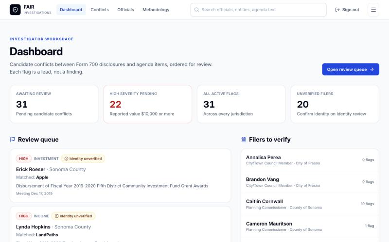
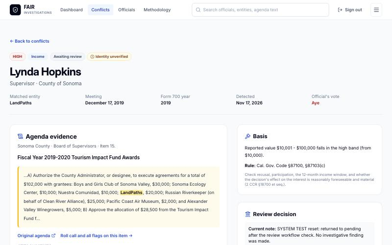
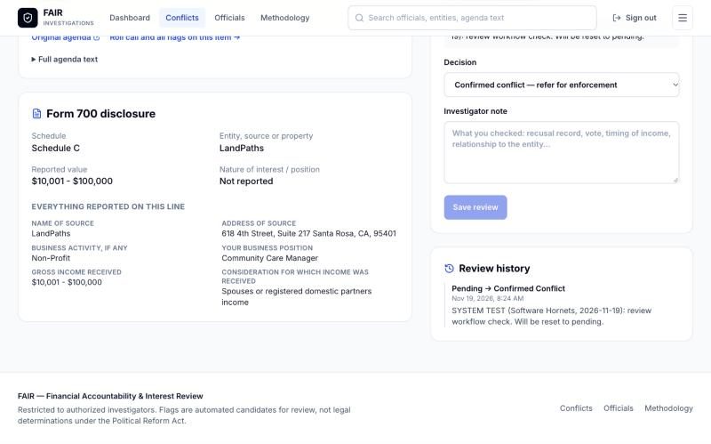
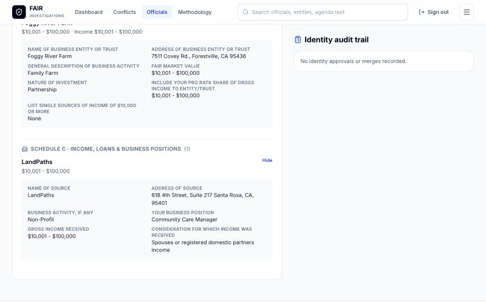
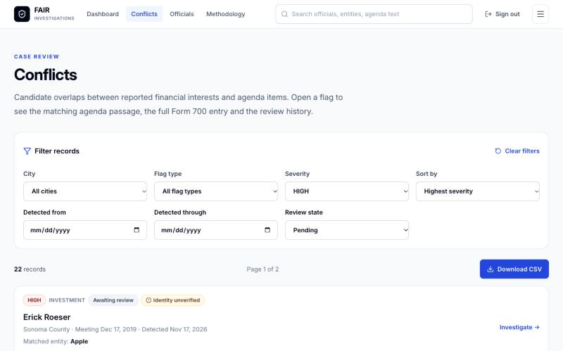
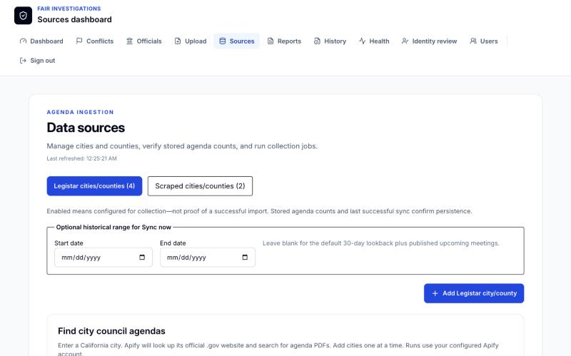
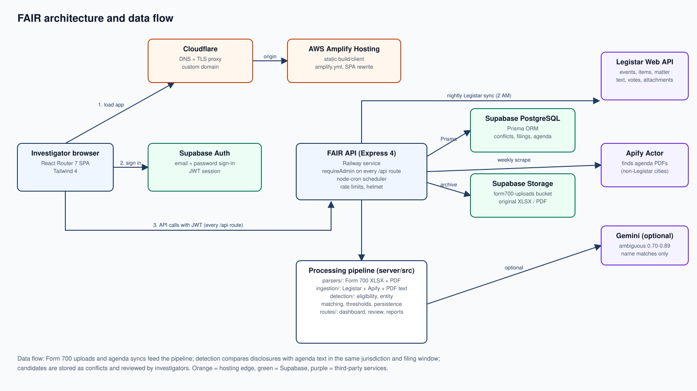

<p align="center">
  
</p>

<p align="center">
  <strong>Conflict-of-interest review workspace for California FPPC investigators.</strong>
</p>

<p align="center">
  
  
  
  
  
</p>

---

## About FAIR

**FAIR** (*Financial Accountability & Interest Review*) helps investigators at the
**California Fair Political Practices Commission (FPPC)** find potential conflicts
of interest. It imports officials' **Form 700** Statements of Economic Interests,
collects city-council and county-board **agendas** (Legistar and agenda PDFs), and
compares every disclosed investment, business position, property, source of
income, gift and travel payment with the text of each agenda item the official
could vote on. Each match becomes a *candidate conflict* showing the agenda
passage, the full Form 700 line, the official's recorded vote and the Government
Code basis; investigators record a decision with an audit trail.

**Why it was built.** Disclosures and agendas live in separate systems, so
checking whether an official voted on something they had a financial interest in
meant reading spreadsheets and staff reports by hand. FAIR automates that
cross-check. For example, it surfaces the client-reported case behind FPPC
No. 22/207: a 2019 Form 700 listing LandPaths as a source of income, and the
Dec 17, 2019 Sonoma County vote approving a $20,000 LandPaths grant. FAIR reports
candidates for review; it does not make legal determinations.

FAIR is an **internal, login-only** application: every page and every `/api`
route except `/health` requires an authenticated owner or admin account. There is
no public access and no self-registration.

## Screenshots

| | |
|---|---|
|  | **Dashboard.** Case-load tiles (awaiting review, high severity, unverified filers), the pending review queue ordered by severity, filers to verify and agenda-source health. |
|  | **Conflict investigation.** The matching agenda passage is highlighted ("LandPaths, $20,000"), with the basis, rule reference, the official's roll-call vote and the review panel. |
|  | **Full disclosure and review history.** Every column of the Form 700 line (address, business activity, spouse income) and each review decision with its note. |
|  | **Official dossier.** Every statement and schedule an official filed, expandable to all original columns, plus candidate conflicts, votes and the identity audit trail. |
|  | **Conflict list.** Filter by city, type, severity, review state and dates; filters live in the URL; authenticated CSV export. |
|  | **Data sources.** Add Legistar cities by browser or API URL, discover agenda PDFs with Apify, sync on demand, and monitor runs. |

More screenshots of every page are in [`docs/assets/screenshots/`](docs/assets/screenshots).

## Features

- **Investigator workspace:** dashboard, conflict list with filters and CSV export, conflict investigation page, official dossiers, agenda items with roll call and attachments, global search, methodology page.
- **Review workflow:** Awaiting review / Confirmed conflict / Not applicable decisions with required notes and a permanent history.
- **Form 700 ingestion:** bulk NetFile XLSX and individual XLSX/PDF uploads; every column kept; amendments applied per schedule; corrected filings replace earlier ones in place.
- **Agenda ingestion:** nightly Legistar sync with full matter text (staff report and recommended action), roll-call votes and attachments; Apify Actor for cities without Legistar.
- **Detection engine:** same-jurisdiction and filing-window eligibility; exact, alias and acronym matching (PG&E = PGE = Pacific Gas and Electric); context checks for ordinary-word names (Apple the company vs. apple the fruit); FPPC disqualification thresholds; related parties inside disclosures (A-2 income sources, tenants). Rules: [`docs/conflict_rules.md`](docs/conflict_rules.md).
- **Administration:** identity review and duplicate merge, PDF reports, import history, system health, user invitations and roles.

## Architecture

<p align="center"></p>

| Part | Technology | Hosting |
|---|---|---|
| `client/` | React 19, React Router 7 (SPA mode), Tailwind 4, Vite | AWS Amplify Hosting behind a Cloudflare domain |
| `server/` | Node.js 22, Express 4, Prisma 6, node-cron | Railway (API + scheduled jobs) |
| `apify/` | TypeScript Apify Actor | Apify platform |
| Database / Auth / Files | PostgreSQL 17, Supabase Auth, Supabase Storage | Supabase |

The data model is shown in [`docs/assets/erd.svg`](docs/assets/erd.svg); Prisma's
[`server/prisma/schema.prisma`](server/prisma/schema.prisma) is the source of truth.

## Getting started

### Prerequisites

- Node.js 22 (20+ works) and npm 10
- Git
- A Supabase project (database URL, project URL, anon and secret keys) and, for
  agenda PDF discovery, an Apify token

### Download and install

```bash
git clone https://github.com/fppc-csus/FAIR.git
cd FAIR
npm install
npm --prefix client install
npm --prefix server install
npm --prefix apify install
```

### Configure

```bash
cp server/.env.example server/.env   # DATABASE_URL, DIRECT_URL, SUPABASE_URL, SUPABASE_SECRET_KEY, FAIR_ADMIN_EMAIL, APIFY_*
cp client/.env.example client/.env   # VITE_API_URL, VITE_SUPABASE_URL, VITE_SUPABASE_ANON_KEY
cd server && npx prisma generate && npx prisma migrate deploy
```

Never put server secrets in `VITE_*` variables. `FAIR_ADMIN_EMAIL` only bootstraps
the first owner; further users are invited from **Users** (see
[`docs/admin-user-management.md`](docs/admin-user-management.md)).

### Run locally

```bash
cd server && CRON_ENABLED=false npm run dev   # API on http://localhost:3001
cd client && npm run dev                      # app on http://localhost:5173
```

Sign in with an owner or admin account at http://localhost:5173/admin/login.

### Useful operations

```bash
# Historical Legistar import (matter text, votes, attachments) for one source
npm --prefix server run backfill:legistar -- --city "Sonoma County" --start 2019-01-01 --end 2020-12-31
# Re-parse archived Form 700 files with the current parsers (dry run; add --apply)
node server/scripts/reparse-form700-filings.mjs
# Repair jurisdiction links between sources and filers (dry run; add --apply)
node server/scripts/repair-jurisdictions.mjs
```

## Testing

Run every automated suite (documentation checks, client, server and Apify Actor):

```bash
npm test
```

Record a dated run for the system test report (verbose and JSON results, type
check, build and Prisma validation in `testing/results/<date>/`):

```bash
bash testing/run-system-tests.sh
```

Other checks:

```bash
npm --prefix client run typecheck && npm --prefix client run build
cd server && npx prisma validate
npm run test:coverage          # coverage for all three workspaces
npm run docs:check && npm run test:docs
```

| Suite | Location | Tools |
|---|---|---|
| Client components and pages | `client/app/**/*.test.tsx` | Vitest, React Testing Library, jsdom |
| API routes, parsers, detection, jobs | `server/tests/unit/` | Vitest, Supertest |
| Database-backed core journey (opt-in) | `server/tests/functional/` | Vitest + isolated PostgreSQL |
| Apify Actor | `apify/tests/` | Vitest |
| Run-for-record results and screenshots | [`testing/`](testing) | — |

The latest recorded run (November 19, 2026): 713 automated tests across client,
server and Actor, plus a browser end-to-end pass. Details and evidence are in the
System Test Report (`docs/deliverables/FAIR-System-Test-Report.docx`).

## Deployment

1. **Database (Supabase):** `npx prisma migrate deploy` from `server/`, then apply
   `supabase/migrations/*.sql`. In Auth → URL Configuration set the Site URL and
   redirect URLs to the production domain.
2. **API (Railway):** deploy `server/` (`npm start`), set the variables from
   `server/.env.example`, set `CRON_ENABLED=true` on exactly one instance, and set
   `CLIENT_ORIGIN` to the site's origin(s), comma-separated during a cutover
   (for example `https://fair.example.gov,https://main.dXXXX.amplifyapp.com`).
3. **Client (AWS Amplify):** connect the repository; Amplify uses
   [`amplify.yml`](amplify.yml) (app root `client`, output `build/client`). Set
   `VITE_API_URL`, `VITE_SUPABASE_URL`, `VITE_SUPABASE_ANON_KEY`, and add the SPA
   rewrite rule documented at the top of `amplify.yml`.
4. **Domain (Cloudflare):** add the custom domain in Amplify, create the CNAME
   records Amplify lists in Cloudflare DNS (DNS-only until the certificate is
   issued, then optionally proxied with SSL mode *Full (strict)*).

Full runbook, restore and rollback steps are in the Maintenance Manual
(`docs/deliverables/FAIR-Maintenance-Manual.docx`).

## Documentation

| Topic | Location |
|---|---|
| Conflict rules and thresholds | [`docs/conflict_rules.md`](docs/conflict_rules.md) |
| Agenda ingestion (Legistar, Apify, PDFs) | [`docs/fair/agenda-ingestion/CONTEXT.md`](docs/fair/agenda-ingestion/CONTEXT.md) |
| Form 700 ingestion | [`docs/fair/form700-ingestion/CONTEXT.md`](docs/fair/form700-ingestion/CONTEXT.md) |
| Scheduled jobs | [`docs/fair/cron-jobs/CONTEXT.md`](docs/fair/cron-jobs/CONTEXT.md) |
| User management | [`docs/admin-user-management.md`](docs/admin-user-management.md) |
| Security launch checklist | [`docs/security-launch-checklist.md`](docs/security-launch-checklist.md) |
| Apify Actor | [`apify/README.md`](apify/README.md) |
| Deliverables (System Test Report, User Manual, Maintenance Manual) | `docs/deliverables/` |
| Codebase map for contributors and coding agents | [`DIRECTORY.md`](DIRECTORY.md), [`CLAUDE.md`](CLAUDE.md) |

## Team

**Software Hornets** — California State University, Sacramento, CSC 190/191 Senior Project, sponsored by the California FPPC.

| Name | Role | Contact |
|---|---|---|
| _Team member_ | _Role_ | _email_ |
| _Team member_ | _Role_ | _email_ |
| _Team member_ | _Role_ | _email_ |
| _Team member_ | _Role_ | _email_ |
| _Team member_ | _Role_ | _email_ |
| _Team member_ | _Role_ | _email_ |

## License

Released under the GNU General Public License v2.0. See [`LICENSE`](LICENSE).
